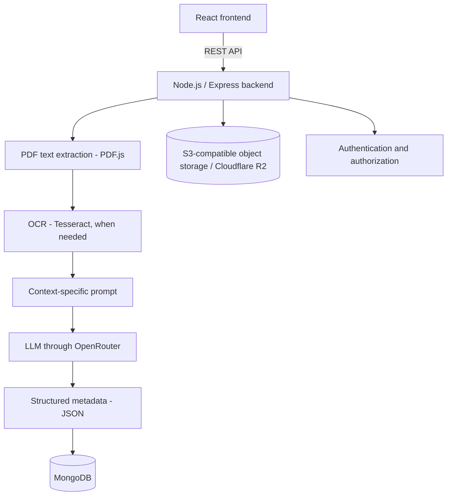

# AI-Powered Document Classification System

A full-stack application for processing PDF documents, extracting their content, classifying them with Large Language Models (LLMs), and generating structured metadata.

This project was developed collaboratively. My contributions focused on backend development, AI integration, database operations, OCR/document processing, testing, project presentation, and feature planning.

> **Project context:** This repository is a portfolio presentation of my participation in the team project. The original source repository and its contributors are credited below.

## Overview

Organizations handle large volumes of documents in different formats and with different information structures. Manually identifying document types and extracting relevant information can be time-consuming.

This application streamlines that workflow through a document-processing pipeline that combines PDF text extraction, OCR, and LLM-based analysis. The extracted information is organized as structured metadata and made available for search and review.

## Main capabilities

- **PDF upload:** supports uploading multiple PDF documents.
- **Text extraction:** extracts embedded text from PDF pages using PDF.js.
- **OCR:** uses Tesseract OCR to recognize text in image-based PDF content.
- **AI-assisted classification:** sends extracted text and context-specific instructions to an LLM through OpenRouter.
- **Structured metadata extraction:** requests document categories and metadata in JSON format.
- **Context-specific prompts:** includes prompt flows for document types such as invoices, educational records, registry-office documents, and SEI-related documents.
- **Document management:** stores document metadata and processing status in MongoDB.
- **Object storage:** stores original PDF files using S3-compatible storage; the project includes Cloudflare R2 integration.
- **Search and filtering:** supports searching documents by filename, category, and selected metadata fields.
- **Metadata review:** provides functionality for reviewing and editing AI-generated metadata.
- **Authentication and authorization:** uses JWT-based authentication and role-based access.
- **Feedback:** includes a mechanism for users to rate the quality of the classification.
- **API documentation:** exposes interactive API documentation through Swagger / OpenAPI.

## Processing workflow

1. A user uploads one or more PDF documents.
2. The backend processes each PDF and attempts to extract embedded text.
3. Image-based content is processed through the OCR service when required by the extraction flow.
4. The extracted text is combined with a context-specific prompt.
5. The application requests an LLM analysis through OpenRouter.
6. The response is parsed and validated as structured JSON.
7. Document metadata and processing information are stored in MongoDB.
8. The original file is stored in object storage and can be retrieved through the application.
9. Users can search, review, and, where authorized, correct extracted metadata.

## Technology stack

| Area | Technologies |
|---|---|
| Frontend | React, Vite, Tailwind CSS, Axios |
| Backend | Node.js, Express |
| AI integration | OpenRouter API, Large Language Models, prompt engineering |
| PDF processing | PDF.js (`pdfjs-dist`), Node Canvas |
| OCR | Tesseract OCR (`node-tesseract-ocr`) |
| Database | MongoDB, Mongoose |
| Object storage | Cloudflare R2, S3-compatible API |
| Authentication | JSON Web Tokens (JWT), bcryptjs |
| API documentation | Swagger / OpenAPI |
| Development and deployment support | Docker, Docker Compose |

## Architecture at a glance

## My contributions

I participated in the project as a developer and contributed to the following areas:

- **Backend development:** implementation and integration of server-side functionality and API workflows.
- **AI integration:** work on the integration with LLM services and the document-analysis flow, including context-specific prompts and structured responses.
- **Database:** contribution to persistence and retrieval of document information and metadata using MongoDB.
- **OCR and document processing:** contribution to PDF text extraction and OCR workflows.
- **Testing:** participation in application testing and validation of features and processing flows.
- **Product and feature planning:** collaboration in defining the application presentation, discussing requirements, and identifying and planning system functionalities.

The project was developed collaboratively; these points describe my areas of contribution and do not imply sole authorship of the application.

## Repository and project credits

- **Original team repository:** [Categorizar-Documentos-AI](https://github.com/rafaelaugustodev/Categorizar-Documentos-AI)
- **Project group:** G01 – GoLedger
- **Video pitch:** [Watch the team presentation](https://www.youtube.com/watch?v=N_9-NKpeZ7Q)

Please refer to the original repository for the source code, full project history, and the contributions of the other team members.

## Notes

- The AI provider/model is configured through the OpenRouter integration. The exact model available may depend on the configured OpenRouter model identifier and service availability.
- This project demonstrates the integration of existing OCR and LLM services; it is not presented as a model trained from scratch.
- Before running or deploying the application, configure environment variables and review the original repository's setup instructions.
- Never commit API keys, passwords, tokens, or real environment files to a public repository.
